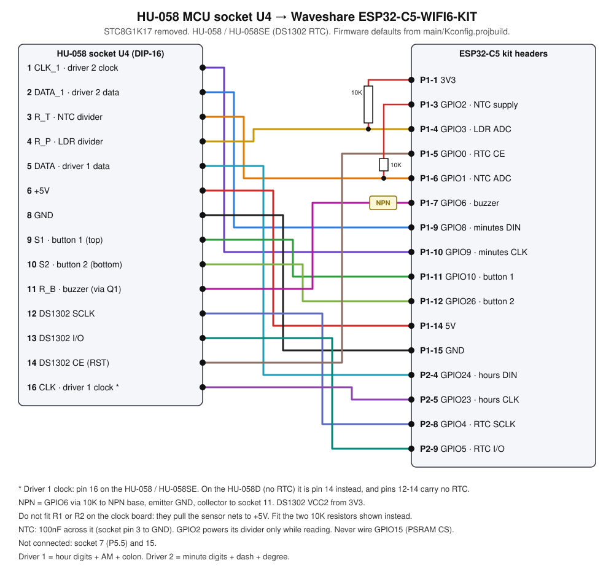

# ESP Clock

ESP32-C5 firmware for the HU-058 LED clock PCB. Drives two AiP33628 LED
drivers via GPIO bit-bang to display time, date and temperature on four
seven-segment digits with RGB LEDs and five annunciators. Time comes from
the board's DS1302 RTC, kept set by NTP over WiFi.

## Features

- WiFi 6 (802.11ax) time synchronisation via NTP (hourly refresh)
- DS1302 RTC as the display clock: NTP sets it on every sync, and it keeps
  time through power cuts and network outages (HU-058 / HU-058SE)
- Automatic WiFi reconnect with backoff, forever; NTP re-syncs as soon as
  the network is back
- Captive portal for initial WiFi setup and configuration
- Settings page at the clock's IP address on your network, applied without
  a restart, with the firmware upload on the same page
- 12-hour (7:30 with AM indicator) or 24-hour (07:30) display
- `LoAd` on the display until the time is valid, instead of a made-up 00:00
- Colon: steady, blink, or blink fast; the upper dot goes out while WiFi is
  down
- Full colour: 16 levels per channel (4096 colours) via binary-weighted
  sub-frames
- Colour modes: solid, gradient, per digit, rainbow cycle, rainbow wave
- 16 brightness levels, or automatic brightness from the light sensor with
  adjustable minimum and maximum
- Date and temperature shown between the time automatically (optional),
  DD-MM or MM-DD
- NTC thermistor temperature readout (Celsius or Fahrenheit), with ADC
  calibration (where the chip supports it) and averaging, in whole degrees
- Buzzer: key beeps, an optional hourly chime, and a power-up beep
- Over-the-air firmware updates from a browser or `curl`, password
  protected, with `OtA` on the display and automatic rollback if the new
  firmware fails to start
- Button controls: view switch, config portal, factory reset
- All settings persisted in NVS flash

## Hardware

| Component | Description |
| --- | --- |
| MCU | ESP32-C5-WROOM-1 (RISC-V 240 MHz, WiFi 6) on a Waveshare ESP32-C5-WIFI6-KIT |
| Display PCB | HU-058 with the STC8G1K17 microcontroller removed |
| LED Drivers | 2x AiP33628 (30-bit shift register, two-wire) |
| Display | 4x seven-segment digits, 5 annunciators, all RGB |
| RTC | DS1302 with CR1220 backup cell (HU-058 / HU-058SE), powered from **3V3** |
| Buzzer | LS1 magnetic buzzer via PNP Q1 |
| Temp sensor | NTC thermistor on HU-058 PCB (NTC to GND with 100nF across it, 10K pull-up to **GPIO2**, powered only while reading) |
| Light sensor | LDR on HU-058 PCB (LDR to GND, 10K pull-up to **3V3**) |
| Buzzer interface | NPN transistor (2N3904 / BC547) pulling R_B low, so no 5V reaches the ESP32 |

### Default Pin Assignments

| Function | GPIO | Notes |
| --- | --- | --- |
| Hours DIN | 24 | AiP33628 data line (hours half) |
| Hours CLK | 23 | AiP33628 clock line (hours half) |
| Minutes DIN | 8 | AiP33628 data line (minutes half) |
| Minutes CLK | 9 | AiP33628 clock line (minutes half) |
| Button 1 | 10 | View switch / hold for config |
| Button 2 | 26 | Used with Button 1 for factory reset |
| NTC ADC | 1 | NTC thermistor voltage divider input (ADC1) |
| NTC supply | 2 | Feeds the NTC divider's 10K pull-up, high only while reading |
| LDR ADC | 3 | Light sensor voltage divider input (ADC1) |
| RTC CE | 0 | DS1302 chip enable (RST) |
| RTC SCLK | 4 | DS1302 serial clock |
| RTC I/O | 5 | DS1302 data (direct; the DS1302 runs from 3V3) |
| Buzzer | 6 | Drives an NPN that pulls R_B (Q1 base via R5) low; push-pull, high = on |
| Status LED | 27 | On-board WS2812 (Waveshare ESP32-C5 kit) |
| USB D+/D- | 14/13 | Console output (USB Serial JTAG) |

All pin assignments are configurable via `idf.py menuconfig` under
"ESP Clock Configuration". The four display pins must be GPIO0-31, because
both drivers are clocked together through the GPIO set/clear registers.

Defaults target the Waveshare ESP32-C5-WIFI6-KIT (ESP32-C5-WROOM-1 module).
Pins to avoid on that board: **GPIO15** (the module's PSRAM chip select;
pulling it low corrupts flash reads and boot-loops the chip), GPIO27
(WS2812), GPIO28 (BOOT key), GPIO11/12 (UART0 to CH343P), GPIO13/14 (USB),
and the strapping pins GPIO7 and 25. GPIO2 is a strapping pin too, but is
ignored while BOOT is high, so it's safe for the NTC supply. GPIO4/5 have
on-board pull-ups and GPIO6 feeds the battery divider, so none of those three suits an ADC input; they
are fine for the RTC and buzzer. ADC1 covers GPIO1-GPIO6 only.

### Status LED

| Colour | Pattern | Meaning |
| --- | --- | --- |
| White | Solid | Booting / lamp test |
| Yellow | Fast flash (50 ms on, 250 ms off) | First WiFi connection in progress (up to 15 s) |
| Green | 1 Hz heartbeat (80 ms flash) | Running, WiFi connected |
| Red | Slow flash (100 ms on, 900 ms off) | WiFi down, retrying |
| Blue | Slow flash (100 ms on, 900 ms off) | Config portal active |

WS2812 LEDs cannot be PWM dimmed; brightness is set by scaling the colour
values (`LED_MAX_LEVEL` in `components/status_led/src/status_led.c`).

### Wiring

The ESP32-C5 kit wires into the STC8G1K17's DIP-16 socket (U4) with the
STC8G removed. Full details, the buzzer and RTC interfacing, board-revision differences
and the kit header map are in [docs/wiring.md](docs/wiring.md). The table
below is for the HU-058 / HU-058SE (with the DS1302 RTC).



| U4 socket pin | Net | ESP32-C5 | Kit header |
| --- | --- | --- | --- |
| 1 | CLK_1 (minutes clock) | GPIO9 | P1-10 |
| 2 | DATA_1 (minutes data) | GPIO8 | P1-9 |
| 3 | R_T (NTC) | GPIO1, plus 10K to GPIO2 and 100nF to GND | P1-6 (10K to P1-3) |
| 4 | R_P (LDR) | GPIO3, plus 10K to 3V3 | P1-4 |
| 5 | DATA (hours data) | GPIO24 | P2-4 |
| 6 | +5V | 5V | P1-14 |
| 8 | GND | GND | P1-15 |
| 9 | S1 (button 1) | GPIO10 | P1-11 |
| 10 | S2 (button 2) | GPIO26 | P1-12 |
| 11 | R_B (buzzer) | NPN collector; GPIO6 via 10K to NPN base | P1-7 |
| 12 | DS1302 SCLK | GPIO4 | P2-8 |
| 13 | DS1302 I/O | GPIO5 | P2-9 |
| 14 | DS1302 CE | GPIO0 | P1-5 |
| 16 | CLK (hours clock) | GPIO23 | P2-5 |

On the HU-058D (no RTC) the hours clock is on pin 14 instead; leave out the
DS1302 wires and turn off **DS1302 RTC fitted** in menuconfig.

**Don't fit R1 and R2 on the clock board.** They pull the sensor dividers
to +5V, which would put up to 5V on the ESP32-C5's ADC pins. Fit 10K
pull-ups instead: the LDR's to 3V3, the NTC's to GPIO2, so the firmware
powers the thermistor only while reading it and it doesn't self-heat. Add
100nF across the NTC to filter LED switching noise.

**Power the DS1302 from 3V3** (its VCC2, pin 1, from kit P1-1 instead of
+5V). It then drives its I/O line only to 3.3V, so all three RTC lines
connect directly.

**Drive the buzzer through an NPN** (2N3904 / BC547): GPIO6 → 10K → NPN
base, emitter to GND, collector to U4 pin 11 (R_B). Q1's base sits at 5V,
so GPIO6 must never connect to R_B directly.

The buttons switch to GND; the firmware enables the internal pull-ups.

## Build

Requires ESP-IDF v6.1.

```bash
# Set up ESP-IDF environment
. $IDF_PATH/export.sh

# Configure for ESP32-C5
idf.py set-target esp32c5

# Build
idf.py build

# Flash and monitor
idf.py -p PORT flash monitor
```

### Upgrading from the single-app partition table

The partition table now has two OTA slots. The first time you flash this
version, flash over USB with `idf.py flash` so the bootloader, partition
table and app all go on together. NVS is in the same place as before, so
saved settings survive; older settings (brightness 1-5, R/G/B channel
checkboxes, blink separator) are migrated automatically. After that, updates
can go over WiFi.

### Configuration

```bash
idf.py menuconfig
```

Under "ESP Clock Configuration":

- **Log output channel** — USB CDC (default) or UART0
- **GPIO pins** — hours DIN/CLK, minutes DIN/CLK, button 1/2, NTC ADC,
  NTC supply, LDR ADC, status LED
- **DS1302 RTC fitted** — on by default (HU-058 / HU-058SE); turn off for
  the HU-058D. CE / SCLK / I/O pins.
- **Buzzer fitted** — on by default, with its GPIO
- **Buzzer test tone** — off by default; plays a continuous 2.7 kHz tone so
  the buzzer driver can be traced with a meter

## Usage

### First Boot

1. Power on the clock — it runs a two-second lamp test, beeps, then shows
   `SEt` and starts a WiFi access point named `ESP-Clock-XXXX`
2. Connect a phone or laptop to the AP
3. A captive portal page opens automatically (or navigate to `192.168.4.1`)
4. Pick your WiFi network from the scanned list (or type a hidden SSID),
   enter the password, choose a timezone, and set display preferences
5. Press "Save & Restart" — the clock connects to WiFi and syncs time via
   NTP, showing `LoAd` until the time is valid. The first sync also sets the
   RTC.

### Normal Boot

After the lamp test the clock shows the time straight away from the RTC,
then connects to WiFi in the background. NTP refreshes the RTC on connect
and every hour after that. With no network the clock keeps running from the
RTC; the upper colon dot stays dark to show it is offline.

Once it is on the network, open `http://<clock-ip>/` in a browser to
change settings. The IP address is in your router's client list or the
serial log.

### Time Sources

| Situation | Display time from |
| --- | --- |
| RTC set and ticking | DS1302 RTC (normal) |
| RTC not fitted, never set, or stopped | System clock, set by NTP |
| Neither yet | `LoAd` |

The RTC holds UTC; timezone and daylight saving are applied for display, so
changing the timezone never needs the RTC to be reset. An RTC time is only
trusted once this firmware has set it from NTP: a flat backup cell, a
halted oscillator, or time left by the stock firmware all show `LoAd` until
the first sync. If the RTC stops ticking the display falls back to the
system clock, and returns to the RTC once it ticks again.

### Button Controls

| Action | Result |
| --- | --- |
| Button 1 press | Cycle time → temperature → date |
| Button 1 hold (2s) | Enter configuration portal |
| Both buttons held (2s) | Factory reset (erases all settings) |

With key beeps on, a press clicks and a hold double-beeps.

### Display Messages

| Text | Meaning |
| --- | --- |
| `8888` (all lit) | Lamp test at power-on |
| `LoAd` | No valid time yet (RTC not set and no NTP sync) |
| `SEt` | Config portal active, join the `ESP-Clock-XXXX` network |
| `OtA` | Firmware update uploading |
| `---C` | Temperature sensor open or shorted |

### Settings

Settings can be changed in two places:

- **Setup portal** (hold button 1, join `ESP-Clock-XXXX`): every setting.
  Saving restarts the clock.
- **Settings page** at `http://<clock-ip>/` on your network: everything
  except the WiFi credentials and the OTA password, so nobody on the
  network can cut the clock off or take over its updates. Changes apply
  as soon as you press Save, with no restart.


| Setting | Description | Default |
| --- | --- | --- |
| WiFi SSID/Password | Network credentials (blank password for an open network). Setup portal only | (none) |
| NTP Server | Time sync server | pool.ntp.org |
| Timezone | City list; stored as a POSIX TZ string so DST is automatic | UTC |
| 24-hour format | 24h (07:30) vs 12h (7:30 + AM) | Off |
| Colon | Steady, blink (once a second), blink fast (twice a second) | Steady |
| Brightness | 1-16, one per driver current step | 11 |
| Automatic brightness | Follow the light sensor between a minimum and maximum | Off (1-16) |
| Colour mode | Solid, gradient, per digit, rainbow cycle, rainbow wave | Solid |
| Colours 1-4 | Colour pickers; how many are used depends on the mode | White |
| Colour cycle speed | Seconds per trip round the colour wheel (rainbow modes) | 30 |
| Show date / temperature | Cycle each in for 3 s between the time | Off |
| Seconds between | Time shown between date/temperature cycles | 30 |
| Date format | DD-MM or MM-DD | DD-MM |
| Temperature unit | Celsius or Fahrenheit | Celsius |
| Temp calibration | Offset in °C (±15, 0.1 steps) added to the reading; the clock's LEDs and electronics warm the thermistor, so this is usually negative. Set it to ambient minus the displayed reading after 15-20 minutes running | 0 |
| Beep on button presses | Click on press, double beep on hold | On |
| Chime on the hour | Two short beeps when the hour changes | Off |
| OTA password | Enables WiFi firmware updates; blank turns them off. Setup portal only | (blank) |

### Firmware Updates over WiFi

Set an OTA password in the setup portal. Then, while the clock is on your
network, either open `http://<clock-ip>/`, enter the password and upload
`build/esp-clock.bin` under Firmware Update, or:

```bash
curl -H "X-OTA-Password: <password>" --data-binary @build/esp-clock.bin \
     http://<clock-ip>/update
```

The clock shows `OtA` while the image uploads, verifies it, and restarts
into it. If the new firmware crashes before reaching its main loop, the
bootloader rolls back to the previous one on the next boot.

The password travels in plain HTTP, so treat it as protection against
accidents on a trusted network rather than against an attacker on it.
The settings page itself has no password: anyone on your network can
change the display settings, but not the WiFi or the firmware.

## Architecture

```text
main.c ──┬── hu058 ──── aip33628 ──── aip33628_hal (GPIO bit-bang)
          ├── clock_fx (colour modes / effects)
          ├── clock_time ── ds1302 (RTC, GPIO bit-bang)
          │       └──────── clock_ntp (esp_sntp)
          ├── clock_sensors (NTC + LDR via ADC)
          ├── buzzer (LEDC tone + playback task)
          ├── buttons ── buttons_hal (GPIO + esp_timer)
          ├── clock_settings (NVS)
          ├── wifi_manager (esp_wifi STA, auto-reconnect)
          ├── captive_portal (soft AP + DNS + HTTP) ── settings_form
          └── web_server (settings page on the LAN) ─┬ settings_form
                                                     └ ota_server (esp_ota)
```

`clock_time` decides what the display shows. At boot it loads a valid RTC
time into the system clock. On every NTP sync it writes the new time to the
RTC on a second boundary (writing the seconds register resets the DS1302's
sub-second counter, so the two line up). It times the display from the
RTC's own seconds tick, which also gives the colon its sub-second phase.

### Portable Components

The `aip33628`, `hu058`, `clock_fx` and `buttons` components contain no
ESP-IDF dependencies. To port to a different platform, implement:

- `aip33628_hal_init()`, `aip33628_hal_send_frame()` and
  `aip33628_hal_send_pair()` for your GPIO API
- a timer calling `hu058_scan_tick()` every `HU058_UNIT_US` (40 us)
- `buttons_hal_init()` with a 20ms periodic timer calling `buttons_poll()`

### Display Scan

Each of the four COM pairs holds the bus for 600 us (15 ticks of 40 us),
split into sub-frames of 1, 2, 4 and 8 ticks. A colour channel at level L
(0-15) is lit in the sub-frames whose bit is set in L. Adjacent sub-frames
with identical data merge, so a saturated colour costs one frame send per
COM pair. A full refresh is 2.4 ms (417 Hz).

`hu058_compile()` builds the schedule into a back buffer and flips it with
a memory barrier, so the scan ISR never reads a half-built frame. Both
drivers are clocked together through the GPIO set/clear registers, and the
whole ISR path is in IRAM (`CONFIG_GPTIMER_ISR_CACHE_SAFE`), so the display
keeps running during flash writes such as OTA updates.

### Timer Architecture

| Timer | Period | Context | Purpose |
| --- | --- | --- | --- |
| Display scan | 40 us | GPTimer ISR | `hu058_scan_tick()`, 417 Hz refresh |
| Main loop | 20 ms | app_main task | Render view, poll RTC, colour effects, brightness |
| Button poll | 20 ms | esp_timer task | Debounce + hold detection |
| Status LED | 50-900 ms | esp_timer task | Flash phases, heartbeat pulse |
| Buzzer | per note | buzzer task | Note sequencing; tone generated by LEDC hardware |
| WiFi retry | 1-60 s | esp_timer task | Reconnect with exponential backoff |
| NTP sync | 1 hour | System | `esp_sntp` automatic refresh, copied to the RTC |

The display scan deliberately uses a dedicated GPTimer rather than an
ISR-dispatched `esp_timer`. When an ISR-dispatched `esp_timer` fires on the
same tick as a task-dispatched one, `esp_timer` skips waking its task, and
every task timer period here is a multiple of the scan period, so they
would never run.

## License

MIT
