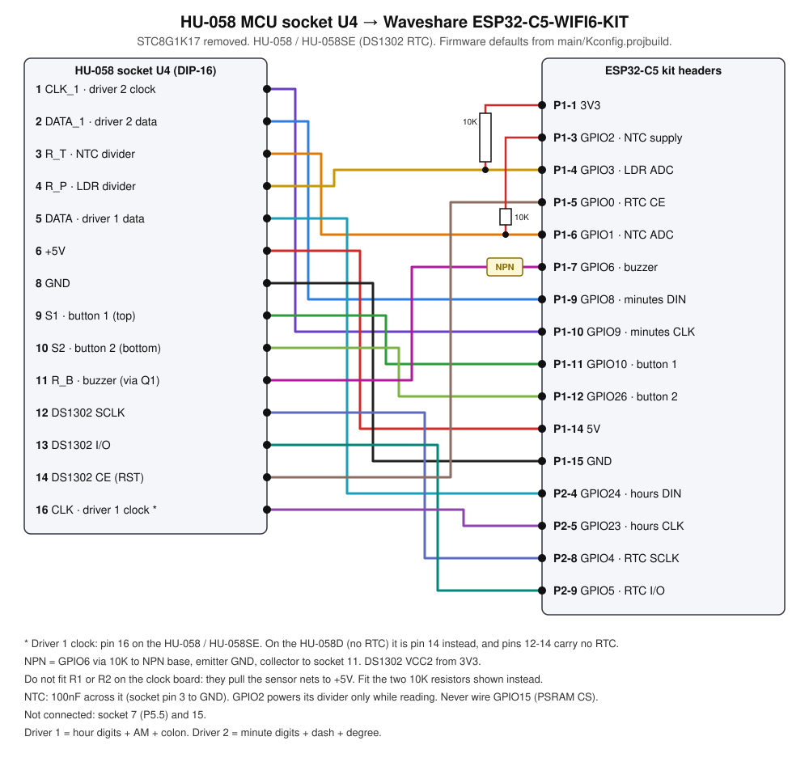

# Wiring the ESP32-C5 kit into the HU-058

The ESP32-C5 replaces the clock's STC8G1K17 microcontroller. Every signal
the firmware needs lands on the STC8G's DIP-16 socket (U4), so the wiring is
point to point from that footprint to the two pin headers on the Waveshare
ESP32-C5-WIFI6-KIT.

This page is for the **HU-058 / HU-058SE**, which carry a DS1302 RTC. The
HU-058D differences are listed under [Board revisions](#board-revisions).



Sources: the HU-058 / HU-058D schematics and pinout in
[misterblack1/HU-058_ESPHome](https://github.com/misterblack1/HU-058_ESPHome)
(`docs/hardware.md`, `docs/wiring.md`), the ESP32-C3 build in
[3ative/HU-058-WiFi-Clock](https://github.com/3ative/HU-058-WiFi-Clock), the
pico-clock DS1302 and buzzer wiring, and the Waveshare ESP32-C5-WIFI6-KIT
schematic in this repo. The diagram is generated by
[images/make_wiring_svg.py](images/make_wiring_svg.py).

## Before you start

| Remove / don't fit | Why |
| --- | --- |
| STC8G1K17 (U4) | The ESP32-C5 drives its pins. Two masters on one bus fight. |
| **R1 and R2** (10K) | They pull the LDR and NTC dividers up to **+5V**. See [Sensors](#sensors-5v-warning). |

Fit everything else: LDR (R3), NTC (R4), DS1302 (U3) with its crystal and
CR1220 cell, buzzer LS1 with R5 and Q1, both buttons and header P3.

Keep the STC8G. Its stock firmware can't be read back out (the STC ISP
protocol has no read command), so a removed chip is the only way to return
the clock to stock.

You also need:

- two 10K resistors (sensor pull-ups: LDR to 3V3, NTC to GPIO2)
- a 100nF capacitor (across the NTC, against LED switching noise)
- an **NPN transistor** (2N3904, BC547 or similar) and a 10K for the
  buzzer (see [Buzzer driver](#ds1302-supply-and-buzzer-driver))
- a wire to feed the DS1302 from 3V3 instead of +5V

## Socket U4 pinout and connections

Pin 1 is the notched/marked end on the silkscreen. Top view, HU-058:

```text
              ┌────╮╭────┐
 CLK_1    1 ──┤    ╰╯    ├── 16  CLK (driver 1 clock)
 DATA_1   2 ──┤          ├── 15  -
 R_T      3 ──┤          ├── 14  DS1302 CE (RST)
 R_P      4 ──┤  STC8G   ├── 13  DS1302 I/O
 DATA     5 ──┤  1K17    ├── 12  DS1302 SCLK
 +5V      6 ──┤          ├── 11  R_B (buzzer)
 P5.5     7 ──┤          ├── 10  S2
 GND      8 ──┤          ├── 9   S1
              └──────────┘
```

| U4 pin | STC8G port | Net | Function | ESP32-C5 | Kit header pin |
| --- | --- | --- | --- | --- | --- |
| 1 | P1.0 | CLK_1 | Driver 2 clock (minutes) | GPIO9 | P1-10 |
| 2 | P1.1 | DATA_1 | Driver 2 data (minutes) | GPIO8 | P1-9 |
| 3 | P1.6/ADC6 | R_T | NTC divider | GPIO1 (ADC1_CH0) + 10K to GPIO2 | P1-6 (10K to P1-3) |
| 4 | P1.7/ADC7 | R_P | LDR divider | GPIO3 (ADC1_CH2) + 10K to 3V3 | P1-4 |
| 5 | P5.4 | DATA | Driver 1 data (hours) | GPIO24 | P2-4 |
| 6 | VCC | +5V | Supply | 5V | P1-14 |
| 7 | P5.5 | - | Not connected | - | - |
| 8 | GND | GND | Ground | GND | P1-15 |
| 9 | P3.0 | S1 | Button (top), to GND | GPIO10 (button 1) | P1-11 |
| 10 | P3.1 | S2 | Button (bottom), to GND | GPIO26 (button 2) | P1-12 |
| 11 | P3.2 | R_B | Buzzer, via R5 to Q1 base | NPN collector (GPIO6 drives the NPN) | P1-7 via NPN |
| 12 | P3.3 | SCLK | DS1302 serial clock | GPIO4 | P2-8 |
| 13 | P3.4 | IO | DS1302 data (two-way) | GPIO5 (DS1302 on 3V3) | P2-9 |
| 14 | P3.5 | RST | DS1302 chip enable (CE) | GPIO0 | P1-5 |
| 15 | P3.6 | - | Not connected | - | - |
| 16 | P3.7 | CLK | Driver 1 clock (hours) | GPIO23 | P2-5 |

Driver 1 carries the two hour digits, the AM mark and the colon. Driver 2
carries the two minute digits, the date dash and the degree mark.

## DS1302 supply and buzzer driver

The ESP32-C5's pins are not 5V tolerant. The DS1302 runs from **3.3V**, so
all three of its lines connect directly. The buzzer transistor sits on the
5V rail, so the ESP drives it through an NPN. No level shifter is needed.

**DS1302 on 3V3.** Feed the DS1302's VCC2 (its pin 1) from the kit's 3V3
(P1-1) instead of the clock's +5V. The DS1302 runs from 2.0-5.5V, and at
3.3V it drives its I/O line only to 3.3V on reads, so GPIO5 never sees
5V. The CR1220 stays on VCC1 (pin 8). The DS1302 runs from VCC2 only while
VCC2 is more than 0.2V above the cell: 3.3V against a 3.0V CR1220 clears
that, but a brand-new cell can read 3.2-3.3V, and until it settles the chip
may draw on the cell while powered. Its draw is microamps, so this costs
little.

- **DS1302 I/O** (GPIO5) is two-way and direct. The kit's 10K pull-up on
  GPIO5 holds it high between transfers.
- **DS1302 SCLK and CE** (GPIO4, GPIO0) are inputs to the DS1302, driven
  directly.

**Buzzer driver.** R_B goes through R5 (10K) to the base of PNP Q1, whose
emitter is at +5V; the magnetic buzzer LS1 is on its collector. The ESP
can't connect to R_B: Q1's base sits at 5V when off, and a 3.3V high would
still leave 1.7V across R5 and Q1, holding it on. Instead:

```text
GPIO6 (P1-7) ── 10K ─── NPN base
                        NPN emitter ── GND
                        NPN collector ── U4 pin 11 (R_B) ── R5 10K ── Q1 base
```

| Part | Connect |
| --- | --- |
| NPN (2N3904, BC547) | Emitter to GND, collector to U4 pin 11 |
| 10K (4.7K also fine) | GPIO6 (P1-7) to NPN base |

Mind the NPN's pinout: facing the flat side, legs down, a 2N3904 is E-B-C
and a BC547 is C-B-E.

- **GPIO6 high** puts about 0.26mA into the NPN's base, far more than it
  needs to saturate while sinking R_B's 0.4mA. R_B goes low and Q1 switches
  the buzzer fully on. The firmware drives a 2.7kHz square wave, push-pull,
  so the buzzer sounds.
- **GPIO6 low** (idle) turns the NPN off. Q1's base then sees only the
  NPN's leakage (nanoamps), so Q1 stays off and no DC flows through the
  buzzer coil. No base-emitter resistor is needed.
- **Before the firmware starts**, GPIO6 is an input, and the kit's battery
  divider (about 300K to ground) keeps the NPN off.
- GPIO6 only ever sees its own 3.3V; the NPN's collector takes the 5V.

## ESP32-C5 kit headers

Header numbering is from the Waveshare schematic (P1 left, P2 right, pin 1
at the end away from the USB connectors).

| P1 | Signal | Use | | P2 | Signal | Use |
| --- | --- | --- | --- | --- | --- | --- |
| 1 | 3V3 | LDR pull-up, DS1302 VCC2 | | 1 | GND | |
| 2 | EN (CHIP_PU) | | | 2 | GPIO11 (U0TXD) | UART console |
| 3 | GPIO2 | **NTC supply** (strapping) | | 3 | GPIO12 (U0RXD) | UART console |
| 4 | GPIO3 | **LDR ADC** | | 4 | GPIO24 | **Hours DIN** |
| 5 | GPIO0 | **RTC CE** | | 5 | GPIO23 | **Hours CLK** |
| 6 | GPIO1 | **NTC ADC** | | 6 | GPIO15 | PSRAM chip select: **never use** |
| 7 | GPIO6 | **Buzzer** via NPN (also battery ADC divider) | | 7 | GPIO27 | on-board WS2812, strapping |
| 8 | GPIO7 | strapping | | 8 | GPIO4 | **RTC SCLK** (10K pull-up on board) |
| 9 | GPIO8 | **Minutes DIN** | | 9 | GPIO5 | **RTC I/O** (10K pull-up on board) |
| 10 | GPIO9 | **Minutes CLK** | | 10 | NC | |
| 11 | GPIO10 | **Button 1** | | 11 | GPIO28 | BOOT key, strapping |
| 12 | GPIO26 | **Button 2** | | 12 | GND | |
| 13 | GPIO25 | strapping | | 13 | GPIO14 | USB D+ |
| 14 | 5V | **+5V from clock** | | 14 | GPIO13 | USB D- |
| 15 | GND | **GND** | | 15 | GND | |
| 16 | VBAT | | | 16 | VBAT | |

The only strapping pin used is GPIO2 (the C5's are GPIO2, 3, 26, 27, 28 for
boot mode, plus 7 and 25). The NTC divider pulls it low at reset, which is
harmless: with GPIO28 (BOOT) high the chip always boots from flash, whatever
GPIO2, 3 and 26 read. GPIO3 (LDR) and GPIO26 (button 2) are the same case.

**Never connect anything to GPIO15** (P2-6). It reaches the header, but on
the WROOM-1 it is also SPICS1, the PSRAM chip select on the flash bus.
Anything that pulls it low, even the NTC divider at reset, selects the PSRAM
alongside the flash, and flash reads come back as garbage: the bootloader
reports `partition 0 invalid magic number` and the chip boot-loops, and
esptool's stub won't start.

GPIO6 also feeds the kit's battery-voltage divider (about 300K to ground), a
negligible load on an output. The kit's own 10K pull-ups on GPIO4 and GPIO5
do no harm on the RTC lines.

## DS1302 RTC

The DS1302 keeps time from its CR1220 cell while the clock is unplugged.
The firmware uses it like this:

- **Display time comes from the RTC.** The display follows the DS1302's
  seconds tick.
- **NTP keeps it right.** The first NTP sync, and every hourly refresh after
  it, is written to the RTC on a second boundary.
- **Holdover.** After a power cut the clock shows the right time straight
  away from the RTC, before WiFi connects, and keeps running from it if the
  network or NTP is down.
- **Stored as UTC.** Timezone and daylight saving are applied for display,
  so changing the timezone never corrupts the RTC.
- **Trusted only once set by this firmware.** A halted oscillator (flat or
  missing cell) or time left by the stock firmware shows `LoAd` until NTP
  sets the RTC.
- **Falls back** to the system clock (NTP) if the RTC stops ticking or reads
  garbage, and switches back once it ticks again.
- **Trickle charger forced off.** The CR1220 is not rechargeable.

## Sensors: 5V warning

On the clock board the LDR and NTC dividers are fed from **+5V**: R1 (10K)
from +5V to R_P with the LDR to ground, and R2 (10K) from +5V to R_T with the
NTC to ground. The STC8G ran at 5V, so that was fine for it.

The ESP32-C5 is a 3.3V part. Through R1/R2, a dark room (LDR at hundreds of
kΩ) or a cold thermistor puts close to 5V on the ADC pin, above the chip's
absolute maximum. The firmware's maths also assumes the dividers run from
3.3V.

So:

1. **Don't fit R1 and R2** (or lift one end of each if they're already in).
2. Fit a **10K from GPIO2 (P1-3) to U4 pin 3** (R_T) and another **10K
   from 3V3 (P1-1) to U4 pin 4** (R_P).
3. Fit a **100nF across the NTC** (U4 pin 3 to GND).

The LDR and NTC stay where they are, to ground.

The NTC divider is powered from GPIO2 rather than 3V3 so it's live only
while the temperature is read. With the divider always on, the thermistor
dissipates about 0.27mW and reads warm. The firmware drives GPIO2 high,
waits 8ms for the 100nF to charge (at most 10K || NTC, under 1ms time
constant), averages 16 ADC samples and drives it low again: about 9ms in
every 500ms. The capacitor filters the noise the LED drivers' switching
couples into the sensor wiring.

Even so, the clock's own LEDs and electronics warm the NTC by several
degrees. Set **Temp calibration** on the settings page to ambient minus the
displayed temperature once the clock has run for 15-20 minutes.

## Power

The clock and the ESP32-C5 share the 5V rail and ground: U4 pin 6 to kit
P1-14 (5V), U4 pin 8 to P1-15 (GND). Header P3 on the clock carries the same
+5V and GND if that's easier to reach.

Power everything from the clock's own micro USB. The kit's 3.3V regulator
(MP1605, 2A) runs from the 5V pin.

The kit's 5V pin sits behind Schottky diodes from its two USB-C ports, so
plugging a USB cable into the kit while it's wired in feeds 5V onto the
clock rail too. The diodes stop the clock's supply back-feeding the computer,
but the computer's USB port then has to power the whole panel. That's fine
for flashing; avoid a full-white lamp test on a computer port. A full-white
panel draws about 1.2A.

## Buttons and buzzer

Both buttons switch their net to ground and nothing on the clock board pulls
them up (the STC8G used its own port pull-ups). The firmware turns on the
ESP32's internal pull-ups, so no resistors are needed and the button lines
never see 5V.

| Button | Net | GPIO | Press | Hold 2 s |
| --- | --- | --- | --- | --- |
| 1 (top) | S1 | GPIO10 | Time → temperature → date | Config portal |
| 2 (bottom) | S2 | GPIO26 | - | With button 1: factory reset |

The buzzer gives a short click on each button press, a double beep on a
hold, a beep at power-up and, if enabled, two beeps on the hour. Both the
key beep and the hourly chime can be turned off in the setup page.

## Display lines and logic levels

The AiP33628 drivers run from 5V, and on paper want 0.7 × VDD (3.5V) for a
logic high. In practice they switch near half rail. The ESP32's 3.3V outputs
drive the panel without a level shifter, as in the ESPHome and C3 builds.

If the panel is ever flickery, shows a wrong digit for a frame, or briefly
shows garbage, the levels are marginal. A 74AHCT125 buffer on the four display
lines (powered from 5V) is the fix. The BSS138 module is too slow for them.

The four display GPIOs must be GPIO0-31, because the firmware writes both
buses at once through the GPIO set/clear registers. All four defaults
qualify.

## Board revisions

| | HU-058 / HU-058SE | HU-058D |
| --- | --- | --- |
| Timekeeping | DS1302 RTC + CR1220 cell | ESP-01S over serial, no RTC |
| Driver 1 clock | U4 pin **16** | U4 pin **14** |
| U4 pins 12-14 | DS1302 SCLK / I/O / CE | not used / not used / driver 1 clock |
| U4 pins 15-16 | not used / driver 1 clock | ESP-01S link (leave unconnected) |

For the HU-058D: wire driver 1 clock (GPIO23) to pin 14, leave out the
DS1302 wires and its 3V3 feed, remove the ESP-01S, and turn off
**DS1302 RTC fitted** in menuconfig.

## Changing pins

All pins are set in `idf.py menuconfig` → **ESP Clock Configuration**. The
defaults match the table above:

| Option | Default |
| --- | --- |
| Hours driver DIN / CLK | GPIO24 / GPIO23 |
| Minutes driver DIN / CLK | GPIO8 / GPIO9 |
| Button 1 / Button 2 | GPIO10 / GPIO26 |
| NTC ADC / LDR ADC | GPIO1 / GPIO3 |
| NTC divider supply | GPIO2 (-1 = pull-up on 3V3) |
| DS1302 RTC fitted | yes |
| DS1302 CE / SCLK / I/O | GPIO0 / GPIO4 / GPIO5 |
| Buzzer fitted / GPIO | yes / GPIO6 |
| Status LED | GPIO27 |

If you move them: the ADC pins must be on ADC1 (GPIO1-6) and should avoid
GPIO6 (battery divider) and GPIO4/5 (on-board pull-ups). Keep off GPIO15
(PSRAM chip select), the strapping pins (GPIO7, 25, 27, 28; GPIO2 is fine for
the NTC supply, see above), GPIO13/14 (USB) and GPIO11/12 (UART console).

## First power-up check

1. With nothing plugged in, check for a short between +5V and GND, that U4
   pin 3 measures about 10K to GPIO2 (P1-3) and U4 pin 4 about 10K to the
   kit's 3V3 pin, and that neither goes to +5V. Check nothing is wired to
   GPIO15 (P2-6).
2. Check U4 pin 11 goes only to the NPN's collector, never straight to the
   kit, and that the DS1302's VCC2 (pin 1) goes to 3V3, not +5V. Powered
   and idle, GPIO5 should read about 3.3V, GPIO6 about 0V, and U4 pin 11
   about 5V.
3. Power from the clock's micro USB. The display should run the lamp test
   (`8888`, every LED white) for two seconds, then beep.
4. Watch the serial log:
   - `LDR: … ohm, temperature: … C` should read a sensible room temperature,
     and the LDR value should drop when you shine a light on it.
   - The first boot reports `RTC has no valid time … waiting for NTP`, then
     `RTC set from NTP` once WiFi is up.
   - Unplug for a minute and power up again with WiFi off: the log reports
     `RTC time … UTC loaded` and the display shows the right time at once.
